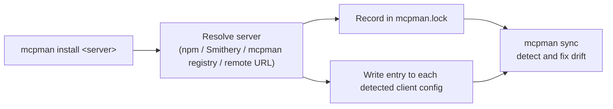

# mcpman

**The package manager for MCP servers.** Install an MCP server once and write it into every AI client you use, from a single CLI.

[](https://www.npmjs.com/package/mcpman)
[](./LICENSE)
[](https://github.com/tranhoangtu-it/mcpman)

---

## The Problem

Every AI client keeps its MCP server list in a different file, with a different format and location: JSON in one place, TOML or YAML in another, and an app-data path that changes per operating system. Adding one server by hand means finding and editing several of these files. Keeping them consistent afterwards is harder, because nothing records which servers you installed, at which version, or with which secrets. mcpman does that bookkeeping for you.

## How it works



mcpman detects which supported clients are present, writes the server entry in each client's own config format, and records the install in a lockfile (`mcpman.lock`). `mcpman sync` then compares the lockfile with the client configs and fixes any differences.

## Quick start (under 60 seconds)

Requires Node.js 20 or newer.

```bash
npm install -g mcpman

# Install an MCP server into your AI clients
mcpman install @modelcontextprotocol/server-github

# See what is installed
mcpman list

# Check health, and keep every client in line with the lockfile
mcpman doctor
mcpman sync --dry-run
```

Useful variations, all taken from the `install` flags:

```bash
# Target one client, skip prompts, pass an env var
mcpman install @modelcontextprotocol/server-github --client cursor --yes --env GITHUB_TOKEN=...

# Install a remote (HTTP/SSE) server
mcpman install --url https://example.com/mcp --name my-server

# Restore everything from mcpman.lock (no server argument)
mcpman install
```

## Features

- **One install, many clients.** Writes to the config of each detected client (10 supported, see below).
- **Multiple sources.** Install by package name, with a `smithery:` prefix, with an `mcpman:` prefix (mcpman registry), or from a remote URL.
- **Remote servers.** HTTP and SSE transports via `install --url`, with optional `--header` values.
- **Lockfile.** `mcpman init` creates `mcpman.lock`. `mcpman install` with no arguments restores from it, and `rollback` restores a previous snapshot.
- **Drift detection.** `mcpman sync` shows a diff table of what is missing or extra in each client, with `--dry-run`, `--remove`, and `--source <client>` to use one client as the source of truth.
- **Secrets vault.** `mcpman secrets` stores encrypted secrets, and `mcpman run` starts a server with the secrets injected.
- **Diagnostics.** `doctor`, `status`, `health`, `test`, `bench` (JSON-RPC initialize latency), and `audit` (security vulnerabilities and trust scores).
- **Version control.** `outdated`, `update`, `pin`, and `rollback`.
- **Team sharing.** `mcpman team` manages a shared config in `.mcpman/team.json`.
- **Runs as an MCP server itself.** `mcpman serve` exposes mcpman over stdio for AI agents.
- **Extras.** Embedded web dashboard (`dashboard`), plugins for custom registries (`plugin`), skills and agent-config sync (`skill`, `agent`), shell completions for bash, zsh and fish.

## Supported clients

Paths are resolved in `src/utils/paths.ts`. `<AppData>` is `~/Library/Application Support` on macOS, `~/.config` (or `$XDG_CONFIG_HOME`) on Linux, and `%APPDATA%` on Windows.

| Client | Config file |
| --- | --- |
| Claude Desktop (`claude-desktop`) | `<AppData>/Claude/claude_desktop_config.json` |
| Cursor (`cursor`) | `<AppData>/Cursor/User/globalStorage/cursor.mcp/mcp.json` |
| Windsurf (`windsurf`) | `<AppData>/Windsurf/User/globalStorage/windsurf.mcpConfigJson/mcp.json` |
| VS Code (`vscode`) | `<AppData>/Code/User/settings.json` |
| Claude Code (`claude-code`) | `~/.claude/.mcp.json` |
| Roo Code (`roo-code`) | `<AppData>/Code/User/globalStorage/rooveterinaryinc.roo-cline/settings/mcp_settings.json` |
| Codex CLI (`codex-cli`) | `~/.codex/config.toml` |
| OpenCode (`opencode`) | `~/.config/opencode/opencode.json` |
| Continue (`continue`) | `~/.continue/config.yaml` |
| Zed (`zed`) | `~/Library/Application Support/Zed/settings.json` (macOS), `~/.config/zed/settings.json` (otherwise) |

The identifier in parentheses is the value accepted by `--client` and `--source`.

## Commands reference

Run `mcpman <command> --help` for flags. Descriptions below are the CLI's own (`src/commands/*.ts`, registered in `src/index.ts`).

| Command | Description |
| --- | --- |
| `install` | Install an MCP server into one or more AI clients |
| `remove` | Remove an MCP server from one or more AI clients |
| `list` | List installed MCP servers |
| `search` | Search for MCP servers on npm or Smithery registry |
| `info` | Show detailed metadata for an MCP server (installed or from registry) |
| `init` | Initialize mcpman.lock in the current project |
| `sync` | Sync MCP server configs across all detected AI clients |
| `diff` | Show config diff between two AI clients |
| `migrate` | Migrate MCP server configs from one AI client to another |
| `doctor` | Check MCP server health and configuration |
| `status` | Show live process status for installed MCP servers |
| `health` | Real-time health monitoring dashboard for installed MCP servers |
| `test` | Test MCP server connectivity and capabilities |
| `bench` | Benchmark MCP server latency (JSON-RPC initialize) |
| `audit` | Scan installed MCP servers for security vulnerabilities and trust scores |
| `validate` | Validate lockfile and client configs against expected schema |
| `outdated` | Check installed MCP servers for newer versions available on the registry |
| `update` | Check for and apply updates to installed MCP servers |
| `upgrade` | Upgrade mcpman to the latest version |
| `pin` | Pin a server to a specific version |
| `rollback` | Restore a previous lockfile snapshot |
| `why` | Show why a server is installed (provenance, clients, profiles) |
| `run` | Run an installed MCP server with vault secrets injected |
| `logs` | Stream stdout/stderr from an MCP server |
| `watch` | Watch a local MCP server for file changes and auto-restart |
| `link` | Register a local MCP server directory with AI clients |
| `create` | Scaffold a new MCP server project |
| `publish` | Publish current package to the mcpman registry |
| `secrets` | Manage encrypted secrets for MCP servers (`set`, `list`, `remove`) |
| `env` | Manage per-server environment variables (`set`, `get`, `list`, `del`, `clear`) |
| `config` | Manage mcpman CLI configuration (`set`, `get`, `list`, `reset`) |
| `profiles` | Manage named server configuration profiles |
| `group` | Manage named server groups (`add`, `rm`, `list`, `delete`, `install`, `run`) |
| `template` | Manage install templates (`save`, `apply`, `list`, `delete`) |
| `alias` | Manage command aliases (`add`, `remove`, `list`) |
| `team` | Manage shared MCP configurations for teams (`init`, `add`, `remove`, `sync`, `share`, `audit`, `list`) |
| `skill` | Manage skills: install from a JSON spec or npm package, list, remove, sync rules to clients, export |
| `agent` | Manage agent/mode definitions and sync them across supported clients (`sync`, `list`, `export`) |
| `plugin` | Manage mcpman plugins for custom registries (`add`, `remove`, `list`) |
| `registry` | Manage custom registry URLs |
| `notify` | Manage event webhooks and shell hooks (`add`, `remove`, `list`, `test`) |
| `export` | Export mcpman config, lockfile, vault, and plugins to a portable JSON file |
| `import` | Import mcpman config, lockfile, vault, and plugins from an export file |
| `replay` | Replay a previous mcpman command from history |
| `serve` | Start mcpman as an MCP server (stdio transport) for AI agent use |
| `dashboard` | Start the mcpman embedded web dashboard |
| `completions` | Generate shell completion scripts (bash, zsh, fish) |

## Related

- [mcphub](https://github.com/tranhoangtu-it/mcphub): companion project.

## License

MIT. See [LICENSE](./LICENSE).
